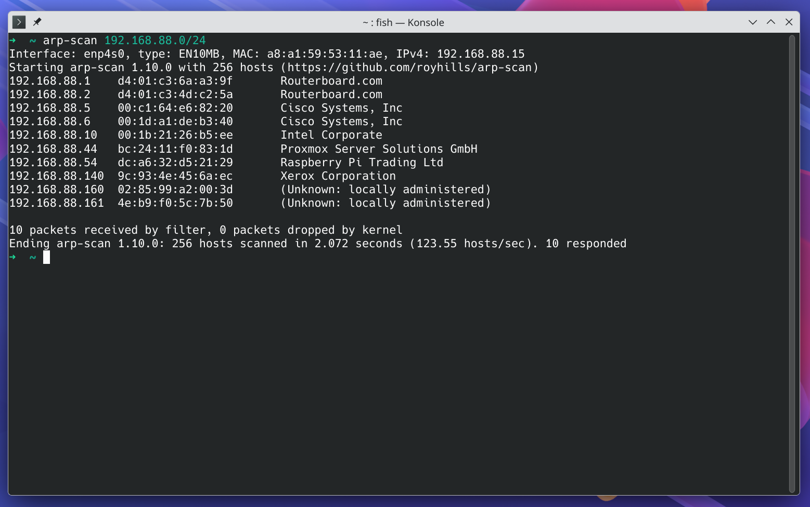

+++
title = "[DRAFT] ARP!"
description = "Learning why network switches are so cool!"
date = "2026-10-04"
draft = true
+++

Hello there!

So, I can never remeber what IP addressed I have give to devices in my network, or what IP address my router has assigned to each but recently I've been learning about ARP (or [Address Resolution Protocol](https://en.wikipedia.org/wiki/Address_Resolution_Protocol)) and tools like `arp-scan` and I wanted to share how cool it is!

Lately I've been learning networking in preparation for my CCNA exam, and I've been learning about this really cool technology called ARP! (or [Address Resolution Protocol](https://en.wikipedia.org/wiki/Address_Resolution_Protocol))

So here's the story, in your local network, when you want to send a message to a device, you need both the IP address _but also_ the MAC address of the device. But why would you need two addresses you say? That is a great question that would make this post longer than what I want it to be... but the briefest answer is, your network switch doesn't speak IP addresses, all that it knows is what devices (identified by their MAC address) are connected to what port, and when it receives a packet with some MAC address, it just forwards it to the physical Ethernet port that that device is connected to. Isn't that cool!? 

Anyways, I bet you've never written `ping AA:BB:CC:DD:EE:FF:GG:HH` Ain't nobody got time for that... so how does your computer knows the MAC address for device 192.168.88.140 when you want to ping it? Well, it asks, literaly!

Take a look at this convo in Wireshark

Even though I ran a ping command, there's some communication that happens before, and that is ARP.

It all start with my computer asking everybody in the network, _"Hey, who's got 192.168.88.140?"_ (My workstation has an AsRock motherboard...). Every single device in my network got that message because it was broadcasted, that is, blasted to every single device. My network being a well behaved one, only the correct recipient answered, that is my Xerox printer saying, _"I have 192.168.88.140 and my MAC address is ....."._ And with that my computer has everything it needed to send the ping message with both the IP and MAC address in the network packet!

As your computer talks with other devices in your local network it starts making a list of all the neighbors it knows.

On Linux you can see that list with `ip neighbour show` and if you want to see for yourself the computer asking for the MAC address of a neighbor it doesn't know you can make it forget all neighbors MAC addresses with `sudo ip neighbour flush all`.

As you can imagine there are some interesting consequences to this mechanism... what is I have an impostor and says that they are the X address!? Nice question, look up ARP spoofing... ;-)

Also, if every single device received that message... what if I have a nefarious or misbehaving device that is trolling sending broadcast messages non-stop? Well, look up Broadcast storm! (and be responsible with your knowledge!)

Anyways, that is ARP in a nutshell!
